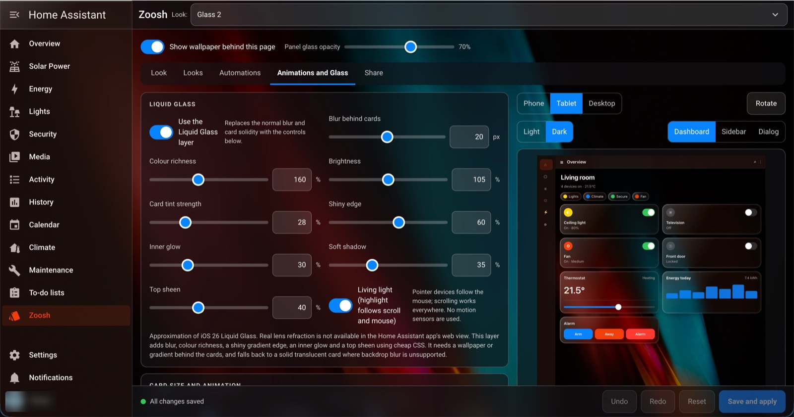
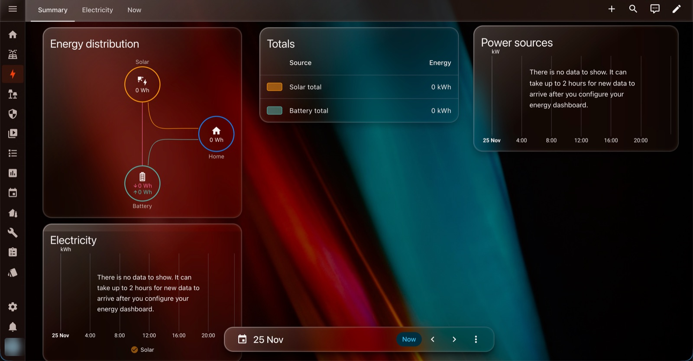
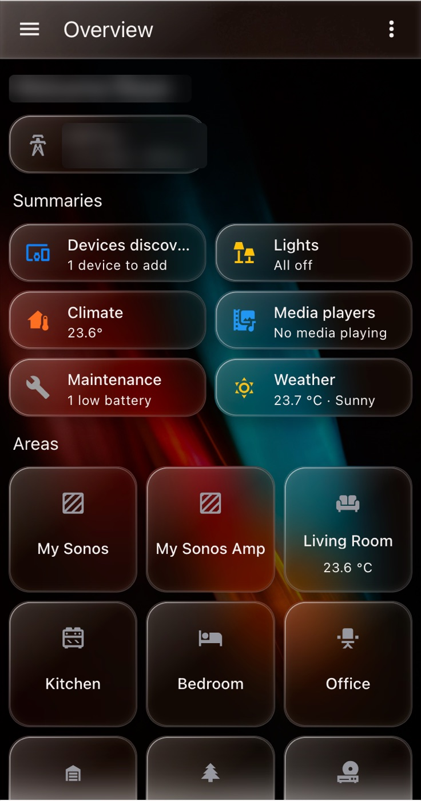
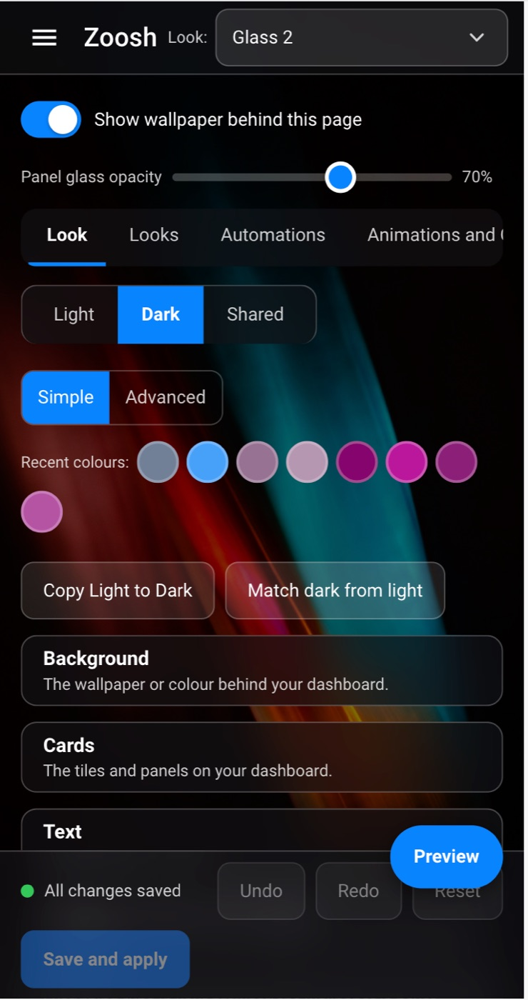
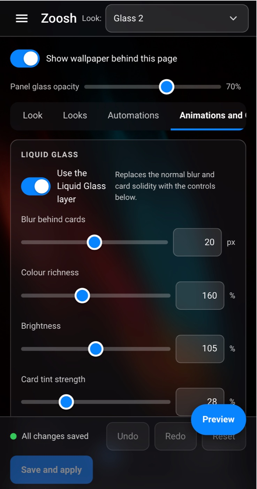

# Zoosh - Home Assistant Theme Studio

Make Home Assistant feel alive: theme editor, card scale and animations, in one panel.

**Version 1.2.2 (release candidate).** Zoosh adds an admin-only **Zoosh** item to the sidebar. Build complete themes ("Looks"), see them on a phone, tablet or desktop preview, add glass, shimmer and motion effects, and let Home Assistant switch Looks by time of day, by what a device is doing, or per person.



<p>
  
  
</p>

<p>
  
  
</p>

_Screenshots show the default "Glass" look over the included wallpaper. Names and device labels are blurred._

## Features

- **Looks.** Up to 12 saved Looks, each written as its own theme named `Zoosh - <name>` in `/config/themes/zoosh.yaml`. Six starters: Glass, Solid, Midnight, Sunrise, Alert and Liquid Glass. Add, duplicate, rename, delete, set a default, and apply one with a tap.
- **Share codes.** Export a Look as a short `zoosh1:...` code and import a friend's code. Imports are validated by the server exactly like a save.
- **Simple and Advanced editor.** Light, Dark and Shared tabs, plain-language sections, copy light to dark, match dark from light, undo and redo (20 steps), recent colours, and a wallpaper picker with upload, drag and drop, and a gallery of your existing images. Colour, corner roundness, blur, text, cards, sidebar, header, dialogs, icons and inputs.
- **Live preview.** Phone, tablet (portrait and landscape) and desktop mock-ups, light and dark, dashboard, sidebar and dialog views, with your wallpaper behind. Pure CSS, no external requests.
- **Liquid Glass approximation.** Backdrop blur, colour richness, brightness, a shiny gradient edge, inner glow, soft shadow and a top sheen, with optional "living light" that follows scroll and the mouse. See the limitations below.
- **Animations (all optional).** Card size, hover and press scale, entrance effects, switch press effect, glass shimmer, accent-colour ripple, springy dialogs, view fade, sidebar slide, a slowly drifting wallpaper. All are turned off by the device's reduced-motion setting and by Performance mode.
- **Automations.** A day/night or custom time schedule (uses `sun.sun` when you have it), up to 8 reactive rules ("when this entity is that, use this Look") with priority, a 5 second debounce and a 30 second minimum dwell, a Pause switch, test buttons, and a log of the last 20 decisions.
- **Per-person Looks.** Map a Home Assistant user to a Look. Their browser applies it once when it changes and never overrides a theme they picked themselves. A changed mapping takes effect on that person's next page load (or app relaunch), not instantly.
- **Wallpaper palette and contrast.** Suggests five whole-Look palettes from your wallpaper (cards, text, accent, sidebar, header, dialogs), lets you choose which parts to apply and to Light, Dark or both, with undo. Checks WCAG AA/AAA contrast for cards, header, sidebar, selected item and dialogs (using the wallpaper's left and top strips), with a one-click fix per pair. Runs in your browser.
- **The panel wears your wallpaper.** The Zoosh page itself is painted with the current Look's wallpaper behind frosted glass surfaces (switch and opacity slider at the top; remembered per browser).

## Install

### With HACS (custom repository)

1. HACS > the three dots > **Custom repositories**.
2. Add this repository's URL, `https://github.com/Blugecko/zoosh`, with category **Integration**.
3. Install **Zoosh**, then restart Home Assistant.

### Manually

1. Copy the folder `custom_components/zoosh` to `/config/custom_components/zoosh`.
2. Restart Home Assistant.

### Then

1. Settings > Devices & services > Add integration > **Zoosh** (one click, no options).
2. In `configuration.yaml`, make sure themes are loaded from a folder, then restart or reload:

   ```yaml
   frontend:
     themes: !include_dir_merge_named themes
   ```

3. Do a full page refresh (or relaunch the Home Assistant app). **Zoosh** appears in the sidebar for administrators.

## Upgrading

**From 1.0.0 (the theme was called `Zoosh`).** Your saved settings become one Look called **Glass** and the theme is now named `Zoosh - Glass`. On the first start Zoosh rewrites `/config/themes/zoosh.yaml` and reloads themes, and if the system theme was the old `Zoosh` it switches it to `Zoosh - Glass` for you. Individual profile choices are not touched: open your profile in Home Assistant and pick **Zoosh - Glass** (the old `Zoosh` entry is gone).

## Default look and your own wallpaper

A fresh install starts with the **Glass** Look: Liquid Glass depth over two wallpapers that ship with Zoosh (one for light mode, one for dark mode, served from the integration itself, so no file needs copying). The navy-to-warm gradient colours behind them are the fallback if an image cannot load. It adds a subtle shimmer, spring dialogs and a gentle card entrance. Five more starters (Solid, Midnight, Sunrise, Alert, Liquid Glass) are in **Looks > Add a starter Look** and use gradients only. Starters only seed an empty install or are added on request; they never change Looks you already have.

**Using your own wallpaper.** In **Look > Light** (or **Dark**) open **Background**, set the type to *Wallpaper image* and drop an image onto the picker, or press *Upload*. Zoosh stores it in `/config/www/wallpapers` (served as `/local/wallpapers/...`; if the `www` folder did not exist when Home Assistant started, restart once). The picker's gallery shows the two **Included with Zoosh** images and **Your uploads**. Removing an included image only clears the selection. Use "the same image for light and dark" for one picture, or pick separate images per mode. Make sure you have the right to use any photo you upload.

**Sections spacing is off by default.** The panel can write `ha-view-sections-*` variables (column width and gaps) for the Sections dashboard view, but these variables could not be confirmed in Home Assistant, so the option is off. Turn it on under Look > Shared > Layout spacing (Advanced) if it works for you.

## Using it

1. Open **Zoosh**, pick a Look (top bar) and edit it. Press **Save and apply** (bottom right). Home Assistant writes `/config/themes/zoosh.yaml`, reloads themes and, if you leave the box ticked on the Looks tab, switches the whole house to that Look.
2. Optional: **Automations** tab to change Looks by time, by entity state or per person. Turn **Automations on**, save, and use **Test** to see it work.

## FAQ

**Why is card-mod not needed?** Zoosh writes a normal Home Assistant theme (colours, radius, blur, fonts, wallpaper and the sizes Home Assistant already reads). The animations and glass layer come from one small script that Zoosh loads for you, which styles Home Assistant's own cards. There is nothing to add to each card.

**Will it slow my dashboard?** Blur is the expensive part, especially on older iPhones. Use **Performance mode** (Animations and Glass tab) to switch blur and every animation off in one go. Animations are only transforms and opacity. The continuous ones pause while the tab is hidden, and everything animated is off when the device asks for reduced motion.

**What does Save and apply reset?** Nothing outside Zoosh. It rewrites `/config/themes/zoosh.yaml` (all your Looks, regenerated) and stores your Looks in Home Assistant's `.storage/zoosh`. Hand edits to `zoosh.yaml` are overwritten on the next save. Your other theme files are not touched.

**Can I change the theme for one device only?** No. Home Assistant exposes a system-wide default theme to integrations (`frontend.set_theme`), so schedules and rules change it for everyone who has not picked their own theme in their browser. Per-person Looks are the exception: each browser applies the person's Look once, with a small best-effort script (see limitations).

**Removing it.** Settings > Devices & services > Zoosh > Delete. This removes the sidebar item, deletes Zoosh's stored settings (`.storage/zoosh`) and deletes `themes/zoosh.yaml` if Zoosh wrote it (a file of that name that Zoosh did not write is left alone). Browsers that already have Home Assistant open keep running the effects script until their next page reload. Wallpapers you uploaded are not deleted (the log says so); remove them from `www/wallpapers/` yourself, or use the Delete button in the picker's gallery before uninstalling. Then delete `custom_components/zoosh` and reload themes. Browser data is described under Privacy.

**Uploaded wallpapers.** Uploads are re-encoded in your browser (this removes EXIF, GPS and XMP information) and the server strips metadata again. Files are named `wallpaper-<12 hex>.<jpg|png|webp>` after a hash of their content; your original file name is not kept. At most 30 uploaded files and 60 MB in total are accepted. **Uploaded wallpapers are served at `/local/` without sign-in; do not upload photos of people or your home if your Home Assistant is reachable from the internet.**

**If a theme file already exists.** If `themes/zoosh.yaml` exists and was not written by Zoosh, it is copied to `zoosh.yaml.bak-<timestamp>` before Zoosh writes its own.

**Two admins.** Saving checks a revision number, so a second tab or admin that has not reloaded cannot silently overwrite or delete Looks. It shows a Reload button instead.

## Privacy

Everything stays on your Home Assistant. Zoosh has **no telemetry**, makes **no outside requests**, loads **no external fonts, images or scripts**, and the wallpaper analysis runs in your browser.

**What is stored, where, and for how long**

- `.storage/zoosh` (a private Home Assistant storage file) holds your Looks and, if you use Automations, the **mapping from Home Assistant user ids to a Look** and your **rule entity ids and values** (for example `alarm_control_panel.home is armed_away`). It stays until you change it or uninstall. Set a person to "none" in Automations to remove their mapping; users that no longer exist are removed automatically when automations are saved. Deleting the integration deletes this file.
- `themes/zoosh.yaml` holds your Looks as a theme and is deleted on uninstall if Zoosh wrote it.
- Uploaded wallpapers in `www/wallpapers/` stay until you delete them (the gallery has a Delete button for your own uploads). They are **public** under `/local/` without sign-in. Metadata is stripped (see above). The two bundled photos are public as well.
- The only thing a non-admin browser can ask the server is "which Look is mine?"; the answer contains only that person's Look name.
- **Rules can reveal state to everyone.** Because Home Assistant can only change the theme system-wide, a rule such as "alarm armed means Alert look" changes how Home Assistant looks for every user, so anyone can infer that the alarm is armed or that someone is home or away. Only use rules whose state you are fine with the household seeing.
- **Diagnostics** (Share tab) shows your browser's user agent, screen size and which CSS features work. It is shown on screen only; nothing is sent unless you copy and paste it yourself.
- **Browser storage** (localStorage, never sent to the server): panel: `zoosh_tour_done`, `zoosh_level`, `zoosh_preview`, `zoosh_sections`, `zoosh_recent`, `zoosh_wall`, `zoosh_glass`, `zoosh_pal_targets`; effects script: `zoosh_my_sig`, `zoosh_my_theme`. It also reads (never writes) Home Assistant's own `selectedTheme` to avoid overriding a theme you picked. Clearing the site data removes all of it.
- The two bundled wallpapers are Unsplash photos under the Unsplash License and are not covered by the project licence (see Licence).
- If other people use your Home Assistant, tell them what Zoosh stores, because the household exemption in privacy laws such as POPIA and GDPR may not cover shared or publicly reachable systems.

## Limitations (please read)

- **System-wide `set_theme`.** Schedules and rules change the default theme for everyone (see the FAQ).
- **The effects script depends on Home Assistant internals.** Cards, dialogs, the sidebar and dashboard views are styled by looking inside Home Assistant's own web components. A Home Assistant update can move things; if so the effect simply stops (no errors, no broken UI) until Zoosh is updated. Themes themselves keep working.
- **Liquid Glass is an approximation.** Real lens refraction (SVG displacement inside a backdrop filter) does not work in iOS WebKit, and Home Assistant's app uses a web view. Zoosh paints the look with blur, saturation, a gradient edge, glow and sheen instead. "Living light" uses scroll and mouse position only; no motion sensors.
- **Per-person Looks use Home Assistant's frontend `settheme` event**, which is not a documented public API. It is best effort and does nothing if it does not respond.
- **View transitions and the drifting wallpaper are best effort**, because Home Assistant may reuse elements or structure them differently.
- A "number tick" animation on sensor values is not included: it would mean rewriting Home Assistant's own text.
- **Not yet verified in a real Home Assistant or real WebKit.** The automated tests use stand-ins for Home Assistant. This line stays until the owner has confirmed it on a real installation.

## Development

Standalone tests (no Home Assistant needed):

```
python3 tests/test_yaml_gen.py
python3 tests/test_automation.py
python3 tests/test_runtime.py
python3 tests/test_storage.py
python3 tests/test_files.py
node --check custom_components/zoosh/frontend/zoosh-panel.js
node --check custom_components/zoosh/frontend/zoosh-fx.js
```

The CSS variables a Look carries all start with `zs-` (for example `zs-card-scale`, `zs-glass`, `zs-shimmer`).

## Credits

Included wallpapers (used under the [Unsplash License](https://unsplash.com/license), credited as a courtesy):

- `zoosh-dark.jpg`: photo by Ryunosuke Kikuno, https://unsplash.com/photos/mcVQ-UkbyLE
- `zoosh-light.jpg`: photo by Radoslav Bali, https://unsplash.com/photos/rhnZzt9XblE

See `custom_components/zoosh/wallpapers/CREDITS.md`.

## Licence

The code is released under the **Apache License 2.0** (see `LICENSE` and `NOTICE`). Zoosh is free. The two bundled wallpaper photographs are **not** covered by that licence: they are used under the Unsplash License (free to use and redistribute, no attribution required but given as a courtesy; they may not be sold without significant modification or compiled into a competing photo service). Images you upload yourself are your responsibility.

Made by Riaan van Dyk, Blugecko Applications.
